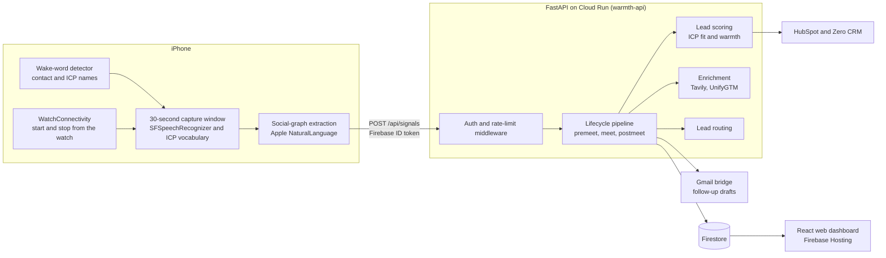

# Warmth: event lead intelligence

Event conversations are easy to lose before anyone logs them, so Warmth captures a short on-device transcript when it hears a contact's name, scores the lead, and drafts the follow-up.

Warmth is an iPhone app with a Python backend. The Xcode project also contains an Apple Watch companion, though the iPhone target does not embed it yet. The phone listens for names from your contacts and target list, transcribes a short window on the device, and sends a structured signal to the API. The backend scores the person, can enrich and sync the lead, and drafts a follow-up email. The web dashboard is where you review it.

[Built at the GTM Hackathon, 2nd place](HACKATHON.md).

## What it does

At a conference, the useful part of a conversation is often gone by the next morning. Warmth holds onto who you spoke to and what mattered, then does the triage and the CRM admin:

1. **Listen.** The phone builds wake words from your contacts and target list ("hey anna", or just "anna"). When it hears one, it opens a short transcription window on the device.
2. **Extract.** People, organisations and relationships are pulled out of the transcript on the phone. The backend receives a structured signal, including a short transcript excerpt, rather than the audio.
3. **Score and route.** The backend scores how well the person fits your ideal customer profile and how warm the conversation was. It can then decide where the lead should go, enrich it, and sync it to the CRM.
4. **Follow up.** A follow-up email is drafted through the Gmail bridge, and the web dashboard shows the event, the scores and the draft.

## How it works



## Technical highlights

- **Name-triggered wake word** (`iOS/Warmth-iOS/Warmth-iOS/Warmth/Services/WakeWordEngine.swift`). This wraps the Soniqo `SpeechWakeWord` detector. It builds a keyword per contact, with different thresholds and boosts for "hey" plus the name, and for the bare name. `EventListeningEngine` plays a haptic on the phone when a wake word matches, and `AppModel` starts it from the roster.
- **Short capture window tuned to your vocabulary** (`Services/CaptureWindow.swift`). An `SFSpeechRecognizer` session, 30 seconds by default, uses a custom language model built from your target-customer vocabulary (`Models/ICPVocabulary.swift`), so terms such as "RevOps" or "Series B" come through.
- **On-device extraction** (`Services/SocialGraph/SocialGraphEngine.swift`). Apple NaturalLanguage picks out people and organisations, and relationships are extracted on the phone before anything is sent.
- **Apple Watch companion.** `project.yml` defines `WarmthWatch` and `WarmthWatchWidget` targets. The iPhone target does not embed them yet. On the phone, `WatchSessionService` is wired so a watch start or stop request calls `AppModel.startCapture` / `stopCapture`.
- **Scoring that asks for strength on both axes** (`packages/ml/warmth_model.py`).
  - ICP score = 0.7 × fit + 0.3 × topic relevance.
  - Warmth = 0.4 × intent + 0.35 × engagement + 0.25 × relationship.
  - The combined score is half the average of the two and half their product, so a lead that is strong on only one axis is pulled down.
  - Bands, applied to that combined score: hot at 70 and above, warm at 40 and above, cold below that.
  - The source marks these weights as a placeholder heuristic (`model_version="stub-v0"`).
- **Two routers.**
  - `packages/ml/pipeline.py` sends the lead to CRM and outreach when warmth improved on the pre-meet prediction (the uplift threshold defaults to 0). Otherwise it routes toward the founder community.
  - `apps/listener/classifier/lead_classifier.py` chooses me, team, founders or community from keyword counts in the transcript and topics.
- **Lifecycle pipeline** (`apps/lifecycle/`: `premeet.py`, `meet.py`, `postmeet.py`, `signal_ingest.py`, `contact_sync.py`). API routers live in `apps/api/routers/`.
- **Per-person context** (`packages/core/models/person.py`). Each transcript window can produce a `PersonalContext` (communication style, values, topic weights, learnings, pain points). Those fold into a `PersonNode`, and `to_narrative()` turns the node into a short CRM summary. Extraction is heuristic unless `WARMTH_USE_AGENT` is set, in which case `AgentContextExtractor` calls the Cursor SDK.
- **Protection around ingest and scraping:**
  - Firebase ID-token middleware scopes each request to the caller's account (`apps/api/middleware/auth_middleware.py`). `/health` stays open.
  - A rate limiter guards `POST /api/signals` (`signal_rate_limit.py`).
  - Server-side fetches check the URL first (`packages/core/url_safety.py`): HTTPS only, credentials and fragments rejected, private and loopback addresses blocked, and an optional host allowlist via `SCRAPE_URL_ALLOWLIST`.
- **Shared secrets** (`packages/core/secrets.py`). At start-up, values already in the environment stay as they are. Anything still unset can be filled from Google Secret Manager. If GCP is unreachable, the process keeps going on the local environment. `scripts/secrets_sync.py` pushes and pulls the shared keys; config knobs, including `WARMTH_DEMO_USER_EMAIL`, are skipped on push.
- **CRM mapping** between HubSpot and Zero CRM contact schemas (`packages/integrations/hubspot/`, `packages/integrations/zero_crm/mapper.py`).

## Finding your way around

```text
iOS/Warmth-iOS/          SwiftUI iPhone app and Apple Watch companion (XcodeGen project)
apps/api/                FastAPI app, routers, middleware, Firestore-backed store
apps/lifecycle/          premeet / meet / postmeet pipeline and signal ingest
apps/listener/           lead classifier and conversation intelligence
apps/agent/              event and meet pipelines
apps/scraper/            event attendee sources (Playwright is optional)
packages/ml/             warmth model, lead scorer, clustering
packages/integrations/   HubSpot, Zero CRM, UnifyGTM, Tavily, Gmail and Calendar, Lightfern, Faxxing, ASR
packages/core/           auth, secrets, URL safety, demo-user config
web/                     React, Vite and Tailwind dashboard (Firebase Hosting)
infra/                   Cloud Run env file and Firebase client helpers
scripts/                 deploy, smoke tests, data import and migration helpers
tests/                   unit and integration tests
```

Firestore and Storage rules live at the repo root (`firestore.rules`, `storage.rules`), and `firebase.json` points Hosting at `web/dist`.

## Testing

```bash
uv sync
uv run pytest tests/unit
```

`uv sync` installs the dev dependency group, which includes pytest and pytest-asyncio. `make test-unit` runs the same file.

Twenty-seven unit tests in `tests/unit/` cover the ICP filter, keyword engine, LinkedIn enricher, signal rate limit, URL safety, the Firestore user store, and the demo-user configuration. GitHub Actions runs them on pull requests and on pushes to `main` (`.github/workflows/unit-tests.yml`). A separate workflow auto-resolves merge conflicts on pull requests and does not run tests.

`tests/integration/` has nine tests:

- Two Cursor SDK tests and three Tavily tests are skipped unless `CURSOR_SDK_API_KEY` or `TAVILY_API_KEY` is set.
- Four tests in `test_e2e_signals.py` call the FastAPI app in-process. The unit-test workflow does not run them.

`scripts/docker_smoke_test.sh` and `scripts/e2e_smoke.py` smoke-test the container and an end-to-end flow. They are outside CI.

The iPhone project has XCTest sources under `iOS/Warmth-iOS/Warmth-iOS/WarmthTests/`. This CI job does not build the Xcode project. The web dashboard has no test script.

## Stack

- **iPhone, and the Watch targets:** Swift, SwiftUI, the Speech framework, Soniqo wake word, Apple NaturalLanguage, WatchConnectivity and Firebase Auth.
- **Backend:** the API container uses Python 3.11. The project accepts 3.10 up to, but not including, 3.14. FastAPI, Pydantic, uv, Firestore and Google Secret Manager. Directory scraping can use Playwright, installed separately from `uv sync`.
- **Integrations:** HubSpot, Zero CRM, UnifyGTM, Tavily, and Google Calendar and Gmail through the MCP bridge. Cursor SDK, Deepgram and the Gmail client libraries are optional extras in `pyproject.toml`.
- **Web:** React, TypeScript, Vite, Tailwind and Firebase Hosting.
- **Infrastructure:** Docker and Cloud Run.

## Running it

```bash
git clone https://github.com/molyleelatham/warmth-event-lead-intelligence.git
cd warmth-event-lead-intelligence
uv sync
cp .env.example .env               # or: make secrets-pull (needs gcloud ADC and GCP_PROJECT_ID)
make run-api                       # same FastAPI app Cloud Run serves
# or: docker compose up api
```

Set `WARMTH_DEMO_USER_EMAIL` in `.env` if a particular Firebase Auth account should receive the seeded GTM Hackathon roster. Leave it empty and no account is seeded. Docker Compose passes the variable through to the API container.

For the web dashboard, run `cd web && npm install && npm run dev`. For the iPhone app, open the Xcode project under `iOS/Warmth-iOS/` (its README has the details).

### Deployment

The API runs on Cloud Run as the service **`warmth-api`** in the project **`warmth-gtm-hackathon`**, region **`us-central1`**.

`scripts/deploy_cloud_run.sh` deploys that service. It sets `GCP_PROJECT_ID`, `GCP_REGION`, `FIREBASE_PROJECT_ID` and `WEB_ALLOWED_ORIGINS` on the revision.

`infra/cloudrun-env.yaml` holds the longer production set (Firebase auth required, Firestore store, signal rate limits). Apply it with:

```bash
gcloud run deploy warmth-api --source . --region us-central1 \
  --project warmth-gtm-hackathon --env-vars-file infra/cloudrun-env.yaml
```

`FIREBASE_SERVICE_ACCOUNT_KEY` in Secret Manager must hold the service account's JSON. With `USE_FIRESTORE_STORE=true`, each user's data lives under `users/{uid}/…`. To seed a user's dashboard from `data/gtm_hackathon_attendees.json`:

```bash
export GCP_PROJECT_ID=warmth-gtm-hackathon
export WARMTH_DEMO_USER_EMAIL=<firebase-user-email>
uv run python scripts/migrate_user_demo_to_firestore.py
```

The script also accepts the email as its first argument. To deploy the web dashboard, run `cd web && npm run build && firebase deploy --only hosting`.
